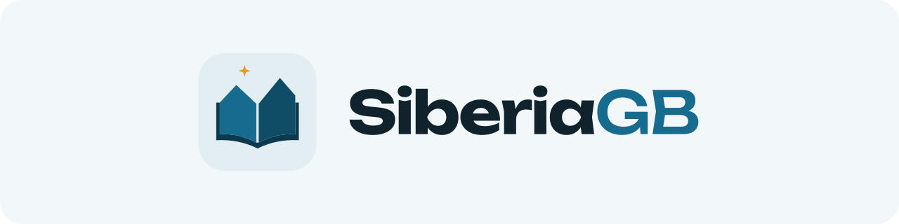

<p align="center">
  <picture>
    <source media="(prefers-color-scheme: dark)" srcset=".github/banner-dark.svg">
    
  </picture>
</p>

[Polski](README.md) | **English** | [Русский](README.ru.md)

SiberiaGB is a fully functional, cross-platform Librus client written using the [Flutter](https://flutter.dev/) framework.

<!-- download-badges:start -->
<p align="center">
  <a href="https://github.com/johnnydotpm/Siberia/releases/download/v1.4.0/SiberiaGB-1.4.0-Android.apk"></a>
  <a href="https://github.com/johnnydotpm/Siberia/releases/download/v1.4.0/SiberiaGB-1.4.0-iOS.ipa"></a>
</p>
<!-- download-badges:end -->

Parent mode follows the Librus account type; the interface role can be changed in profile settings without changing its mailbox. The parent dashboard shows children, lesson end times and unexcused absences. In Attendance, select absences and a class teacher, preview the request and confirm before sending. Request history distinguishes sending mail from school approval: attendance changes only after school data is synced. Quiet hours default to 21:00–07:00 and summaries to 19:00; the operating system may delay scheduled notifications. Integration with the separate e-Usprawiedliwienia module still requires protocol verification.

## Features

- Sign-in with non-expiring sessions
- Several profiles in one app: a parent with two children, or a student at two schools. Each profile keeps its own data, grades, homework and average settings, and switching takes one tap
- "All together" mode: several profiles' data in one view, such as the lessons of a regular and a music school on one timetable. Every item carries its profile's mark, lessons at the same time stand side by side, and a message goes from the profile you pick
- Timetable as a timeline or a list, with merged double lessons and tests shown on the lessons they are set for
- Grades coloured by value and average calculation, including weighted averages and your own value for pluses and minuses
- A grade calculator: how new grades would change the average, and how many it takes to reach a target
- Schedule, calendar, and upcoming events
- Homework grouped by due date, with search
- A Today screen with the current and next lesson and blocks you can hide and reorder
- A "Next lesson" home screen widget (Android and iOS), with per-widget settings on Android, including which profile it shows, or all of them together
- Full messaging support
- Announcements
- Attendance with an attendance chart
- Remarks
- Notifications across eight categories: grades, messages, announcements, remarks, attendance, events, homework, and timetable; with several profiles they carry the profile's name, and each profile has its own switch
- Test reminders the evening before or that morning, at a time you choose (Android and iOS)
- Background data synchronization (Android)
- The app is available in five languages: Polish, English, Russian, German, and Ukrainian
- Works on Android, iOS, Windows and Linux
- A Liquid Glass design: drawn with real system bars on iOS 26 and newer, and recreated by the app itself to the same measurements on Android 10 and newer; the classic design stays available in Settings

## Project structure

The application source code is located in the [`syberia/`](syberia) directory.

## Installation

Download the file for your platform, then run it or install the application.

On Android, `SiberiaGB-<version>-Android-arm64.apk` is smaller and suits almost every phone from recent years. If it does not install, take `SiberiaGB-<version>-Android.apk`, which works on every Android phone, older 32-bit ones included. Either file updates an installation made from the other.

On iOS, install the application yourself using [AltStore](https://altstore.io/), [SideStore](https://sidestore.io/), [LiveContainer](https://github.com/LiveContainer/LiveContainer), or a paid certificate.

The “Next lesson” home screen widget works when the app is installed with AltStore, SideStore or a paid certificate; LiveContainer does not support widgets. With a free Apple ID the widget uses one extra App ID.

For UI testing without a school account, hold the logo on the login screen for five seconds. Demo mode supplies fictional grades, messages, remarks, attendance, lessons, and calendar entries. Messages and refreshes run locally; sign out to leave the demo. Demo school data is not saved between app launches.

## Build instructions

Every local build requires the [Flutter SDK](https://docs.flutter.dev/get-started/install). Run this first from the project root:

```sh
cd syberia
flutter pub get
```

<details>
<summary>Android</summary>

Requires the Android SDK and a configured Flutter environment.

```sh
flutter build apk --release
```

The APK will be in `build/app/outputs/flutter-apk/app-release.apk`.

Without a local Android SDK: run the `SiberiaGB Flutter` workflow in GitHub Actions with `build_android` enabled, then download the `siberiagb-android` artifact.

A build from your own machine is signed with a debug key, so it will not install over a published release. In GitHub Actions the APK is signed with the project's key from the repository secrets `ANDROID_KEYSTORE_BASE64` and `ANDROID_KEYSTORE_PASSWORD`; without them, with a debug key as well. A build signed with a debug key installs as a separate app, SiberiaGB Preview, next to the published one, and a release cannot be made without the key.

</details>

<details>
<summary>iOS</summary>

Local builds require macOS, Xcode, and an Apple Developer Team configured in the Xcode project.

```sh
flutter build ipa --release
```

GitHub Actions does not require a Mac: run the `SiberiaGB Flutter` workflow with `build_ios` enabled, then download the `siberiagb-ios` artifact. Sign and install the IPA yourself, for example with AltStore or SideStore.

</details>

<details>
<summary>Windows</summary>

Requires Windows and Visual Studio with the **Desktop development with C++** workload.

```powershell
flutter build windows --release
```

The application will be in `build/windows/x64/runner/Release`.

</details>

<details>
<summary>Linux</summary>

Requires Linux with Flutter's desktop dependencies installed.

```sh
flutter build linux --release
```

The application will be in `build/linux/x64/release/bundle`.

</details>

## TODO

- Background synchronization on iOS (the periodic task currently registers on Android only)
- Move Librus error messages into the localization layer (they are currently hardcoded in Polish in the client)
- Expand unit and on-device integration tests
- Further accessibility improvements
- Split `lib/src/ui/app_shell.dart` into separate screen files
- More languages

## License and acknowledgements

The code is available under the terms described in the [`LICENSE`](LICENSE) file. SiberiaGB is an **unofficial** client and **is not affiliated with Librus sp. z o.o.**

Some elements of the application are inspired by [Szkolny.eu](https://szkolny.eu/).
